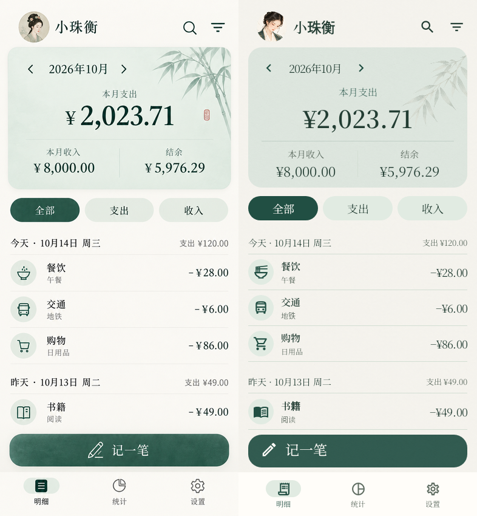
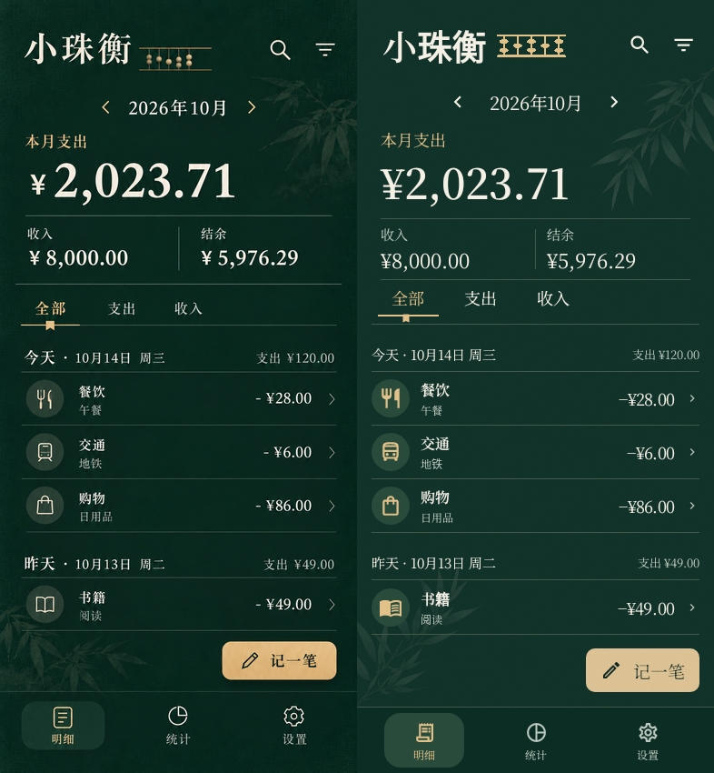

# 青玉雅集 / 墨金藏书首页验收

final result: passed

验收范围：两套首页的原生 Compose 排版、明暗配色、响应式边界，以及相关生产控件的字体与颜色。
不将此结果表述为真机触控、完整端到端流程或启动性能验证。

## 对照对象与方法

- 参考：`docs/design/guofeng/02-celadon-v2.png`、`03-ink-gold-v2.png`，各 853×1844 px。
- 实现：`app/src/test/snapshots/images/com.example.bookkeeping.ui.home_LedgerHomeSnapshotTest_celadon.png`、`com.example.bookkeeping.ui.home_LedgerHomeSnapshotTest_inkGold.png`，各 393×850 px。
- 使用生产 `LedgerHomeContent`、`LedgerBillRow`、`AppBackground`、记账按钮和导航组件，Paparazzi 1.3.5 / Android Layoutlib 渲染。没有另建网页、使用参考图作为页面背景，或用静态图片替代按钮。
- 内容视口 393×850 dp，density=160 dpi，fontScale=1；不绘制系统状态栏、导航手势或手机外框，参考图也无这些系统区域。
- 状态：2026 年 10 月，今天固定为 10 月 14 日，全部筛选；支出 2023.71、收入 8000.00、结余 5976.29；当天三笔、昨日一笔。
- 参考等比例归一至 393×850（原图宽高比取整差小于 1px），与同尺寸实现并排合成 786×850 对照板。左侧参考，右侧实现。
- 复现命令：`gradlew.bat :app:recordPaparazziDebug -PvisualQa --tests "*Ledger*SnapshotTest*"`；比对板：`python tools/compare-ledger-screenshots.py`。
- 已接受的基准可用 `gradlew.bat :app:verifyPaparazziDebug -PvisualQa --tests "*Ledger*SnapshotTest*"` 做后续回归检查。

## 最终证据

放大核对图同样左参考 / 右实现：

- `docs/design/guofeng/qa/celadon-top.png`、`celadon-list.png`。
- `docs/design/guofeng/qa/inkGold-top.png`、`inkGold-list.png`。
- 上半区覆盖标题、金额、收支、选中状态；下半区覆盖分类、备注、金额对齐、CTA 和导航。放大是为了辨认字体、金额完整性与细线，没有改变原截图。

## 修正记录

| 轮次 | 问题 | 修正与复核 |
| --- | --- | --- |
| 1 | P1：深色页标题、分类和日期出现黑色 | Theme 根统一提供 onSurface 内容色。后续深色首页及控件板均为正确浅色文字 |
| 1–2 | P2：青玉概览约 268dp，第四条账目被底栏挤压 | 校准到约 233dp，缩短行距与无效留白；最后对照中四条记录与备注完整出现 |
| 2–3 | P2：列表不透明背景形成条状色块 | 账目行使用透明账页，分隔线保持连续，背景材质不再被色块截断 |
| 2–3 | P2：头像取景太远，算盘缩到小尺寸后难以辨识 | 使用用户原图做脸部取景，重新生成适合 80×32dp 的粗细算盘素材；原生截图核对 |
| 3–4 | P2：墨金筛选横向分布过宽，书签指示过小 | 筛选项采用 80dp 宽、左对齐，选中下划线与书签重新定位 |
| 边界复核 | P2：200% 字号下月份按钮拥挤、超长结余被裁切 | 月份按可用宽度测量，大字号时收支纵向排列；金额测量后必要时完整换行，截图金额完整 |
| 边界复核 | P2：系统栏缩小可用高度时列表空间不足 | 页面可用高度低于 680dp 时收紧头部、概览和日期留白；393×802 内容视口仍可展示四条示例记录 |

过程中的较早对照板保存在本机 `app/build/visual-qa/iteration-1` 与 `iteration-2`，最终证据以上述已保存的对照板和基准截图为准。

## 五项视觉检查

1. **字体**：Noto Serif SC 的 400/600 静态子集，首页数字、短标题、正文统一衬线气质；金额测量包含真实字重、字体缩放和可用宽度。输入键盘继续使用系统数字字体。自定义罕见汉字由系统回退。
2. **排版**：青玉居中金额与玉色面板、墨金通栏概览、日期分组与连续账目、两种 CTA 位置均已对照；大字号汇总主动改变布局，功能按钮保留可触达空间。
3. **颜色**：推荐的浅色青玉 / 深色墨金，以及反向明暗组合均渲染检查。透明容器的文字继承已修正。颜色角色还有现有对比度单测；纹理合成后的逐像素对比度未单独测量。
4. **素材**：使用原有品牌图片、真实生成的纸纤维与竹叶、重新生成的小算盘。未以代码画图替代插画；常规操作与分类使用 Material 图标库。
5. **文案**：月度支出、收入、结余、全部/支出/收入、日期、备注和金额与样例状态一致；选中态和正负号可见。

## 额外渲染场景

共 9 项：两个推荐首页、青玉深色、墨金浅色、320×720 / 130% 字号墨金超长金额、320×720 / 200% 字号青玉超长金额、393×802 青玉，以及两套主题的生产控件板。
控件板复用设置行、统计 SectionCard/MetricCard、记账分类格与四行四列键盘；这是控件检查板，不作为完整统计或设置页的截图。

## 剩余 P3 与验证边界

- 参考图为生成式设计稿，未提供精确字体与所有独立素材。采用可合法嵌入的 Noto 字体及最接近的 Material 图标，部分笔画、纸纹强度和小装饰不逐像素相同。
- 头像使用用户确定的原图；青玉参考中的红色小印章暂未加入。算盘采用适合真实小尺寸的平面清晰版本。
- CTA 保留至少 48dp 的点击区域；大字体与窄屏允许首屏显示更少账目，列表仍可滚动。
- 本机无已连接真机；官方模拟器因缺少可用虚拟化环境启动失败，已改用 Android Layoutlib。没有浏览器控制台检查或真机触摸、侧滑、系统弹窗、IME、厂商适配与帧率测量记录。
- 业务逻辑没有被截图样例替代；查询、筛选、保存、删除仍由原 ViewModel/Repository 执行，另行运行原有业务单测和 Android lint。

## 实施检查表

- [x] 独立首页布局，保留原业务回调
- [x] 推荐主题完整视图与局部区域对照
- [x] 明暗反向组合、窄屏、大字号、长金额检查
- [x] 生产通用控件渲染
- [x] 保存最终截图、基准与复现脚本
- [ ] 真机完整操作与性能检查（需连接安卓设备）

最终构建结果：47 项业务/配色单测通过，9 项截图基准验证通过；Android lint 0 错误、7 项既有警告。非调试 preview 安装包 versionName 1.1.1 / versionCode 6，签名与原安装包一致。
